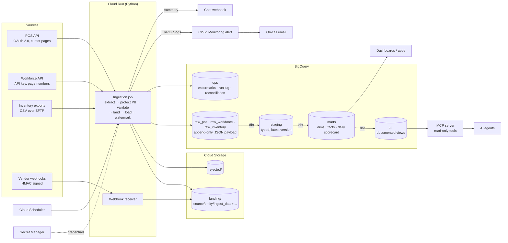

# Hospitality Data Platform on Google BigQuery

End-to-end reference implementation of a data platform for a multi-venue hospitality
business: Python ELT from POS, workforce and inventory systems into **BigQuery**, a
layered **dbt** warehouse, automated data quality and reconciliation, secure
deployment on **Cloud Run** with **Terraform**, CI/CD with **GitHub Actions**, and a
read-only **MCP server** so AI agents can query curated data safely.

> All data in this repository is synthetic. The mock POS and workforce APIs and the
> SFTP inventory exports are generated by `mock_sources/`, so the whole ingestion
> pipeline runs on a laptop with no cloud account.

---

## Architecture



**Daily flow** (`hospitality-elt daily`, scheduled 4:30am Sydney, after the trading-day cutoff):

1. Ingest every source incrementally (watermark minus a 48h lookback for late updates).
2. `dbt build` — models and all data tests in dependency order.
3. Reconcile yesterday's net sales and transaction counts per venue against the POS vendor's own daily report.
4. Post a summary to chat; any failure exits non-zero so Cloud Run retries and the alert policy emails on-call.

An intraday job refreshes POS transactions every two hours during trading.

---

## How the brief maps to this repository

| Requirement | Where |
|---|---|
| Python ELT from POS, workforce, inventory and third-party APIs | `src/hospitality_elt/sources/` |
| REST + OAuth, API keys, webhooks, SFTP, scheduled exports | `http.py`, `sources/pos.py`, `sources/workforce.py`, `webhooks.py`, `sources/inventory_sftp.py` |
| Raw, intermediate and analytics-ready BigQuery layers | `warehouse.py` (raw), `transform/models/{staging,intermediate,marts,ai}` |
| Transformation and modelling with dbt | `transform/` (BigQuery adapter) |
| Cloud Run, Cloud Scheduler, Cloud Storage | `infra/terraform/cloud_run.tf`, `scheduler.tf`, `storage.tf` |
| Consistent identifiers for locations, employees, products, transactions, periods | `transform/seeds/location_crosswalk.csv`, `dim_*`, `business_date` macro, `dim_date` (AU fiscal year) |
| Validation, duplicate detection, error handling, reconciliation | `schemas.py`, `validation.py`, `pipeline.py`, `reconcile.py`, `transform/tests/` |
| Secret Manager and IAM | `secrets.py`, `infra/terraform/secrets.tf`, `iam.tf` |
| Sensitive employee and financial data protected before analytics | `pii.py` (runs before anything is stored) — see [docs/security-and-governance.md](docs/security-and-governance.md) |
| Documented datasets and interfaces for AI agents | `transform/models/ai/`, `src/hospitality_elt/agent_access/` — see [docs/ai-agent-access.md](docs/ai-agent-access.md) |
| Daily ingestion with logging, failure notifications and recovery | `cli.py daily`, `logging_setup.py`, `notify.py`, `monitoring.tf`, [docs/runbook.md](docs/runbook.md) |
| GitHub, automated testing, CI/CD, monitoring | `.github/workflows/`, `tests/` (40 tests) |
| Documentation, deployment and maintenance guides | `docs/` |

---

## Run it locally (no cloud account needed)

```bash
python -m venv .venv && source .venv/bin/activate
make install

# terminal 1: generate synthetic data and start the mock POS + workforce APIs
make mock-api

# terminal 2: run the full ingestion, then an incremental run
make demo
```

Output:

```
✅ Daily data load succeeded
• pos.transactions: success — loaded 8941, rejected 1, dupes 2
• pos.products: success — loaded 25, rejected 0, dupes 0
• pos.locations: success — loaded 4, rejected 0, dupes 0
• workforce.employees: success — loaded 36, rejected 0, dupes 0
• workforce.shifts: success — loaded 779, rejected 1, dupes 0
• inventory.stock_counts: success — loaded 400, rejected 0, dupes 0

Second run (incremental, only the lookback window):
• pos.transactions: success — loaded 716, rejected 0, dupes 0
```

The synthetic data includes deliberate problems — re-sent transactions, a transaction
whose lines don't add up to the header, a shift that ends before it starts — and
employee records containing emails, tax file numbers, bank details and pay rates.
Look in `.local/warehouse/` to see they were deduplicated, rejected (with reasons, in
`.local/landing/rejected/`) and stripped respectively. Every run is logged to
`.local/warehouse/ops_ingestion_runs.jsonl`, including which sensitive fields were removed.

Set `MOCK_FAILURE_RATE=0.2` before `make mock-api` to watch retries and backoff.

```bash
make test        # 40 unit + end-to-end tests
make lint        # ruff
make dbt-parse   # validates every model, test and unit test in the dbt project
```

To load the same data into a real BigQuery project and run dbt there, see
[docs/bigquery-quickstart.md](docs/bigquery-quickstart.md).

---

## Deploy to Google Cloud

1. **Infrastructure** — copy `infra/terraform/terraform.tfvars.example` to `terraform.tfvars`, then:
   ```bash
   cd infra/terraform
   terraform init -backend-config="bucket=<state-bucket>"
   terraform apply
   ```
2. **Secrets** — add values (never through Terraform):
   ```bash
   printf '%s' "$VALUE" | gcloud secrets versions add pos-client-secret --data-file=-
   ```
   Required: `pos-client-id`, `pos-client-secret`, `workforce-api-key`, `sftp-private-key`,
   `sftp-host-key`, `pii-hmac-key` (32+ random bytes), `webhook-secret-pos`; optional `alert-webhook-url`.
3. **GitHub** — set repository variables `GCP_PROJECT_ID`, `GCP_REGION`, and from the Terraform
   outputs `GCP_WIF_PROVIDER` and `GCP_DEPLOY_SA`. Merges to `main` build the image and update the
   Cloud Run jobs and webhook service. No service-account keys are stored anywhere.
4. **First load** — backfill history, then build:
   ```bash
   gcloud run jobs execute hosp-daily --region australia-southeast1 \
     --args="ingest,--source,all,--since,2025-07-01T00:00:00+00:00" --wait
   gcloud run jobs execute hosp-daily --region australia-southeast1 --args="transform" --wait
   ```

---

## Repository layout

```
src/hospitality_elt/
  sources/            one class per source system (POS, workforce, SFTP inventory)
  http.py             OAuth2 client credentials, retries with backoff
  pii.py              drop / pseudonymise sensitive fields before storage
  schemas.py          data contracts per entity (pydantic)
  validation.py       contract checks, duplicate detection, reject threshold
  pipeline.py         extract → protect → validate → land → load → watermark
  storage.py          Cloud Storage landing zone
  warehouse.py        BigQuery raw loads (idempotent), watermarks, run log
  reconcile.py        warehouse vs. source-system totals
  notify.py           chat notifications
  webhooks.py         signed webhook receiver (FastAPI)
  agent_access/       MCP server + SQL guard for AI agents
  cli.py              entry point for all Cloud Run jobs
transform/            dbt project (BigQuery)
  models/staging      typed, deduplicated views over raw JSON
  models/intermediate conformed keys, trading dates, paid hours
  models/marts        dims, facts, daily venue scorecard
  models/ai           documented views exposed to AI agents
  seeds/              venue crosswalk, budgets
  tests/              reconciliation and integrity tests
infra/terraform/      datasets, bucket, secrets, IAM, Cloud Run, Scheduler, alerts, WIF
mock_sources/         synthetic data generator and mock vendor APIs
tests/                pytest suite
docs/                 runbook, data model, security, AI access
```

## Documentation

- [Quickstart: run it on real BigQuery](docs/bigquery-quickstart.md)
- [Runbook: failures, recovery, backfills, adding a source](docs/runbook.md)
- [Data model: layers, grain, keys, metric definitions](docs/data-model.md)
- [Security and governance: PII, IAM, secrets](docs/security-and-governance.md)
- [AI agent access: MCP server and the `ai` dataset](docs/ai-agent-access.md)

## Licence

MIT
